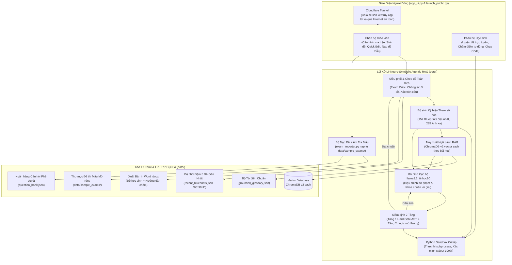

# Hệ thống AI Agent Cục Bộ Kết Hợp Kiến Trúc Neuro-Symbolic Hỗ Trợ Sinh và Kiểm Định Đề Kiểm Tra Tin Học 10 – Chủ Đề F

[](https://www.python.org/)
[-000000.svg?logo=ollama&logoColor=white)](https://ollama.ai/)
[](https://langchain.com/)
[](https://streamlit.io/)
[](https://nvidia.com/)
[](CHANGELOG.md)
[](LICENSE)

Hệ thống AI Agent hỗ trợ sinh đề thi và kiểm định tự động môn **Tin học 10 (Chủ đề F – Giải quyết vấn đề với sự trợ giúp của máy tính: Lập trình Python, Bài 16 đến Bài 32)** theo định dạng cấu trúc đề kiểm tra mới (Trắc nghiệm nhiều lựa chọn 0,25đ; Trắc nghiệm Đúng/Sai bậc thang 0,1 – 0,25 – 0,5 – 1,0đ; Trả lời ngắn 0,5đ; Tự luận lập trình 1,0đ). 

Hệ thống vận hành **100% cục bộ (offline)**, tối ưu hóa toàn diện cho phần cứng biên phổ thông **GPU 4GB VRAM**, giải quyết triệt để các hạn chế cố hữu của mô hình ngôn ngữ nhỏ (3B) như ảo giác cú pháp, tính toán sai lệch và lặp lại mô-típ câu hỏi.

---

## 👥 Nhóm Nghiên Cứu & Đơn Vị Thực Hiện

- **Đơn vị:** Khoa Toán - Tin, Trường Đại học Sư phạm – Đại học Đà Nẵng
- **Lớp sinh hoạt:** 23SPT
- **Nhóm sinh viên thực hiện:**
  1. **Trần Minh Nhật**
  2. **Phạm Kỳ Hải**
  3. **Nguyễn Hữu Lộc**
- **Giảng viên hướng dẫn:** **ThS. Đoàn Duy Bình**

---

## 🧠 Kiến Trúc Đột Phá: Neuro-Symbolic Agentic RAG

Hệ thống kết hợp sức mạnh suy diễn tất định của tính toán ký hiệu (**Symbolic**) với khả năng diễn đạt ngôn ngữ sư phạm tự nhiên của mô hình ngôn ngữ lớn (**Neural**) qua chu trình khép kín:



### Các Trụ Cột Kỹ Thuật Chính:

1. **Bộ sinh Khung bài toán Tham số hóa (`core/symbolic_engine.py` & `core/symbolic_blueprints_ext.py`):**
   - Sở hữu **157 Blueprint độc nhất** (bao gồm **61** MCQ, **28** TRUE_FALSE, **32** SHORT_ANSWER, **36** ESSAY_CODE) với **285 lượt ánh xạ bài học** phủ kín toàn bộ 17 bài học Chủ đề F (Bài 16 – Bài 32).
   - Tự động sinh ngẫu nhiên tên biến, phạm vi giá trị biên, xâu ký tự và cấu trúc điều khiển; không bao giờ lặp lại dữ liệu tĩnh.

2. **Môi trường Python Sandbox Cô lập (`core/sandbox.py`):**
   - Mọi đoạn mã lập trình đều được phân tích cú pháp tĩnh qua `ast.parse()` và thực thi thực tế trong tiến trình con cô lập (`python -I -X utf8`, `timeout=2.0s`).
   - Kết quả xuất chuẩn (`stdout`) được thu nhận trực tiếp từ máy ảo để làm căn cứ khóa cứng 100% đáp án mẫu và lời giải thích chi tiết, loại trừ hoàn toàn việc mô hình 3B tính nhẩm sai.

3. **Cơ chế Kiểm định 2 Tầng (Two-Tier Quality Validation):**
   - **Tầng 1 – Rule Hard Gate (`core/validator.py`):** Kiểm tra tính hợp lệ cú pháp Python, loại bỏ các thư viện ngoài chương trình, chặn câu hỏi chứa cụm từ rò rỉ đề bài, kiểm tra tính độc lập và đơn trị của các phương án, làm sạch mọi chuỗi chỉ thị prompt rò rỉ trong trích dẫn SGK.
   - **Tầng 2 – Fuzzy Logic Quality Scoring:** Đánh giá chất lượng sư phạm liên tục trong đoạn $[0.0, 1.0]$ dựa trên 3 trụ cột: Độ gắn kết nguồn ($40\%$), Chất lượng sư phạm ($30\%$) và Độ cân bằng phương án nhiễu ($30\%$).

4. **Chống Lặp Xuyên 5 Mã Đề & Xáo Trộn Ngẫu Nhiên Thứ Tự Câu Hỏi:**
   - Lưu vết tối đa 90 `blueprint_id` của 5 lần sinh gần nhất vào `data/recent_blueprints.json`.
   - Tự động xáo trộn ngẫu nhiên thứ tự các câu hỏi bên trong từng phần (Phần I, II, III, IV), tạo ra các mã đề có cấu trúc độc lập và khác biệt rõ rệt.

5. **Bộ Nạp Đề Kiểm Tra Mẫu Mở Rộng (`core/exam_importer.py`):**
   - Hỗ trợ giáo viên thả các tệp đề thi mẫu (`.docx`, `.json`, `.txt`, `.md`) vào thư mục `data/sample_exams/` và nạp tự động vào Ngân hàng câu hỏi (`data/question_bank.json`) chỉ bằng 1 cú nhấp chuột trên giao diện Web.
   - Tuyệt đối giữ nguyên kho vector `data/chroma_db_v2` để bảo đảm độ sạch nguyên bản của ngữ cảnh SGK.

---

## 📈 Kết Quả Thực Nghiệm & Đối Sánh Hiệu Năng

Thực nghiệm đối sánh được thực hiện trên cùng một hệ thống phần cứng cục bộ (NVIDIA GeForce RTX 3050 4GB VRAM, vi xử lý Intel Core i5, RAM 16GB):

### Bảng 1: Đối sánh 4 Cấu hình Kiến trúc (Ablation Study)

| Cấu hình thử nghiệm | Tỷ lệ Đạt Tầng 1 | Tỷ lệ Chuẩn Sư phạm ($\ge 0,75$) | Sandbox Verified | Thời gian trung bình / câu | Mức chiếm dụng VRAM |
| :--- | :---: | :---: | :---: | :---: | :---: |
| **Config 1: LLM Thuần (Baseline)** | 50,0% | 50,0% | 41,7% | 7,10s | ~2,6 GB |
| **Config 2: Naive RAG** | 50,0% | 50,0% | 41,7% | 6,54s | ~3,8 GB (VRAM Swap) |
| **Config 3: RAG Khóa Bài + 1-Shot** | 41,7% | 41,7% | 75,0% | 6,79s | ~3,8 GB (VRAM Swap) |
| **Config 4: Neuro-Symbolic Agentic RAG (Đề xuất)** | **100,0%** | **100,0%** | **100,0%** | **4,98s** | **< 3,0 GB (Ổn định)** |

### Bảng 2: Hiệu năng Thực tế Khi Ghép Trọn Bộ Đề (18 Câu – 10,0 Điểm)

| Chỉ số đánh giá | Luồng Thuần LLM Cũ | Luồng Neuro-Symbolic Mới | Mức độ cải thiện |
| :--- | :---: | :---: | :---: |
| **Thời gian tiền truy xuất (Pha 1)** | 29,74s – 78,96s | **0,15s – 0,71s** | Nhanh hơn **~40× – 100×** |
| **Tổng thời gian hoàn thiện đề 18 câu** | 569,12s (~9,5 phút) | **89,64s – 134,54s (~1,5 – 2,2 phút)** | Rút ngắn **~5× – 6×** |
| **Tỷ lệ đạt chuẩn kiểm định lượt đầu** | 61,1% (11/18 câu) | **100,0% (18/18 câu)** | Tuyệt đối hóa chất lượng |
| **Số vòng bù vét (Backfill)** | 2 – 3 vòng lặp | **0 vòng (Hoàn tất ngay lượt 1)** | Tiết kiệm 100% token thừa |
| **Điểm chất lượng Logic mờ trung bình** | 0,958 / 1,0 | **0,989 / 1,0** | Tăng độ sắc nét sư phạm |

---

## 📂 Cấu Trúc Thư Mục Dự Án

```text
NCKH_A.I_Sinhde_Auto/
├── app_ui.py                         # Giao diện Web tương tác Streamlit (2 phân hệ: Giáo viên & Học sinh)
├── launch_public.py                  # Trình khởi chạy kèm đường hầm Cloudflare Tunnel chia sẻ công khai
├── Start_Share_Web.bat               # Kịch bản khởi động nhanh 1-nhấp chuột trên Windows
├── Modelfile                         # Cấu hình lượng tử hóa mô hình Ollama (llama3.2_tinhoc10)
├── requirements.txt                  # Danh mục các thư viện Python cốt lõi của dự án
├── README.md                         # Báo cáo kỹ thuật và hướng dẫn vận hành hệ thống
├── LICENSE                           # Giấy phép mã nguồn mở MIT
│
├── core/                             # Lõi xử lý Neuro-Symbolic, Agentic RAG & Khảo thí
│   ├── symbolic_engine.py            # Động cơ ký hiệu gốc: Khung skeleton & điều phối bốc thăm
│   ├── symbolic_blueprints_ext.py    # Thư viện mở rộng 86 blueprints (tổng 157 blueprints độc nhất)
│   ├── exam_importer.py              # Bộ quét và nạp đề kiểm tra mẫu (.docx, .json, .txt) vào ngân hàng
│   ├── generator.py                  # Đồ thị LangGraph điều phối vòng lặp sinh và tự sửa lỗi
│   ├── validator.py                  # Bộ kiểm định 2 tầng: Tầng 1 Rule Hard Gate & Tầng 2 Logic mờ
│   ├── retriever.py                  # Bộ truy xuất Evidence Package khóa cứng bài học từ ChromaDB
│   ├── sandbox.py                    # Môi trường cách ly chạy thử nghiệm mã lệnh Python an toàn
│   ├── exam_assembler.py             # Bộ ghép đề theo ma trận, phản biện đề exam_critic & xuất Word
│   ├── ingestion.py                  # Trích xuất văn bản sách, giải mã font và lập chỉ mục Vector DB
│   ├── drive_form_sync.py            # Đồng bộ chọn lọc mẫu đề và cấu trúc từ Google Drive
│   └── ocr_onthi.py                  # Xử lý trích xuất văn bản từ các đề thi quét dạng ảnh/PDF
│
├── data/                             # Dữ liệu tri thức nền tảng và tệp cấu hình
│   ├── chroma_db_v2/                 # Cơ sở dữ liệu vector ChromaDB chứa các phân đoạn tri thức sạch
│   ├── sample_exams/                 # Thư mục lưu trữ các đề thi mẫu của người dùng để nạp thêm
│   │   └── HUONG_DAN_THEM_DE.txt     # Hướng dẫn thao tác thả đề kiểm tra mẫu
│   ├── grounded_glossary.json        # Bộ từ điển thuật ngữ lập trình chuẩn hóa
│   ├── ma_tran_de.json               # Ma trận khung đề thi, thang điểm và bảng ánh xạ chỉ báo năng lực
│   ├── exam_templates.json           # Khuôn mẫu trình bày cấu trúc câu hỏi và ví dụ mẫu chuẩn
│   └── recent_blueprints.json        # Bộ nhớ lưu vết 90 blueprint đã sinh chống lặp xuyên 5 đề
│
├── experiments/                      # Nhật ký thực nghiệm, bảng số liệu và đề thi mẫu
│   ├── run_ablation.py               # Kịch bản tự động chạy đối sánh 4 cấu hình thực nghiệm
│   ├── auto_exam_audit.py            # Kịch bản kiểm toán độc lập chất lượng 8 tiêu chuẩn đề thi
│   ├── logger.py                     # Trình ghi vết tự động thông số hệ thống ra tệp CSV
│   ├── ablation_results.xlsx         # Bảng tổng hợp số liệu chi tiết thực nghiệm đối sánh
│   ├── ablation_charts.png           # Biểu đồ trực quan hóa kết quả 3 tiêu chí thực nghiệm
│   ├── system_logs.csv               # Tệp nhật ký lưu vết chi tiết từng lượt suy luận của hệ thống
│   └── sample_exam_neuro_symbolic.docx # Tệp Word đề thi mẫu 18 câu kèm hướng dẫn chấm hoàn chỉnh
│
└── docs/                             # Báo cáo học thuật và tài liệu thiết kế kỹ thuật
    ├── bao_cao_ky_thuat_IMRAD.md     # Bản thảo báo cáo kỹ thuật theo cấu trúc IMRAD quốc tế
    ├── bao_cao_khac_phuc_loi.md      # Nhật ký chi tiết phát hiện và khắc phục các vấn đề kỹ thuật
    └── system_diagrams.md            # 6 sơ đồ kiến trúc hệ thống chuẩn xác theo mã nguồn
```

---

## 🚀 Hướng Dẫn Cài Đặt & Khởi Chạy

### 1. Yêu cầu hệ thống
- **Hệ điều hành:** Windows 10/11 (64-bit), macOS hoặc Linux.
- **Python:** Phiên bản 3.10 hoặc 3.11.
- **Phần cứng:** GPU NVIDIA hỗ trợ CUDA với tối thiểu **4GB VRAM** (hệ thống đã kiểm thử ổn định trên RTX 3050).
- **Ollama:** Cài đặt dịch vụ Ollama cục bộ từ [ollama.ai](https://ollama.ai/).

### 2. Thiết lập môi trường Python

Mở PowerShell hoặc Terminal tại thư mục dự án:

```powershell
# Di chuyển vào thư mục dự án
cd D:\AI_Agent_NCKH

# Khởi tạo môi trường ảo
python -m venv venv

# Kích hoạt môi trường ảo
# Trên Windows:
.\venv\Scripts\activate
# Trên Linux/macOS:
source venv/bin/activate

# Cài đặt danh mục thư viện
pip install -r requirements.txt
```

### 3. Khởi tạo mô hình ngôn ngữ cục bộ

Đảm bảo dịch vụ Ollama đang hoạt động, sau đó tải mô hình cơ sở và khởi tạo mô hình chuyên biệt:

```bash
# Tải mô hình nền tảng
ollama pull llama3.2:3b
ollama pull nomic-embed-text:latest

# Khởi tạo mô hình chuyên môn hóa từ Modelfile
ollama create llama3.2_tinhoc10 -f Modelfile
```

### 4. Khởi chạy ứng dụng

#### Lựa chọn A – Khởi chạy cục bộ (Local Web UI):
```bash
streamlit run app_ui.py
```
Truy cập trình duyệt tại địa chỉ: `http://localhost:8501`.

#### Lựa chọn B – Khởi chạy chia sẻ từ xa qua Internet (Cloudflare Tunnel):
Chỉ cần nhấp đúp tệp **`Start_Share_Web.bat`** (trên Windows) hoặc thực hiện lệnh:
```bash
python launch_public.py
```
Hệ thống sẽ tự động khởi động Streamlit và tạo đường dẫn công khai bảo mật dạng `https://<random-id>.trycloudflare.com` để các thành viên khác có thể truy cập thử nghiệm từ xa trên điện thoại hoặc máy tính khác.

---

## 📝 Nhật Ký Cập Nhật (Changelog)

Toàn bộ lịch sử nâng cấp và ghi chú phát hành qua các phiên bản được lưu trữ chi tiết tại tệp [CHANGELOG.md](CHANGELOG.md).

---

## 📜 Giấy Phép (License)

Dự án được phân phối theo giấy phép mã nguồn mở **MIT License**. Xem chi tiết tại tệp [LICENSE](LICENSE).

---

## 📑 Trích Dẫn Khoa Học (BibTeX)

Nếu bạn sử dụng mã nguồn, kiến trúc hệ thống hoặc dữ liệu thực nghiệm từ dự án này trong các nghiên cứu khoa học, vui lòng trích dẫn theo định dạng sau:

```bibtex
@misc{nckh_ai_sinhde_2026,
  author = {Trần Minh Nhật and Phạm Kỳ Hải and Nguyễn Hữu Lộc},
  title = {Hệ thống AI Agent cục bộ kết hợp kiến trúc Neuro-Symbolic hỗ trợ sinh và kiểm định đề kiểm tra Tin học 10 – Chủ đề F},
  howpublished = {Đề tài Nghiên cứu Khoa học Sinh viên, Khoa Toán - Tin, Trường Đại học Sư phạm – Đại học Đà Nẵng},
  advisor = {Đoàn Duy Bình},
  year = {2026},
  url = {https://github.com/TrAn-MInh-NhAt/NCKH_A.I_Sinhde_Auto}
}
```
