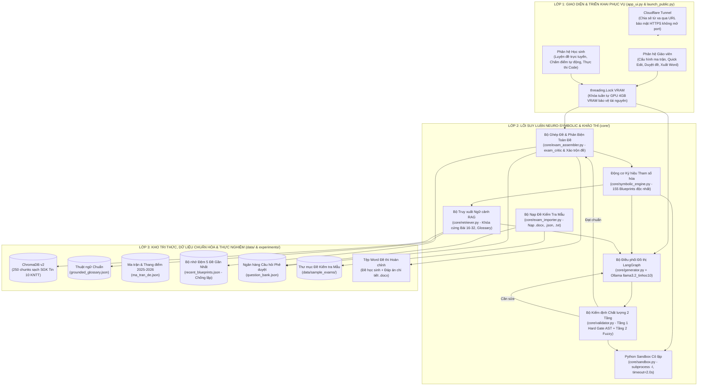
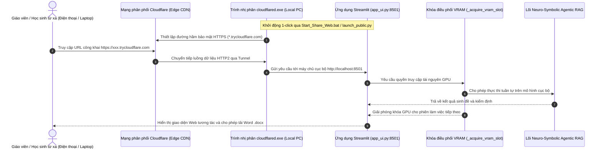
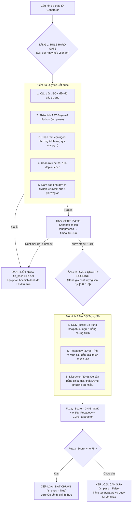
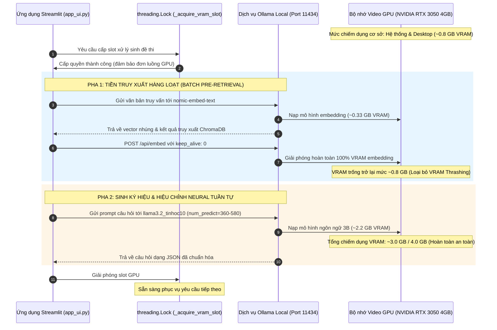
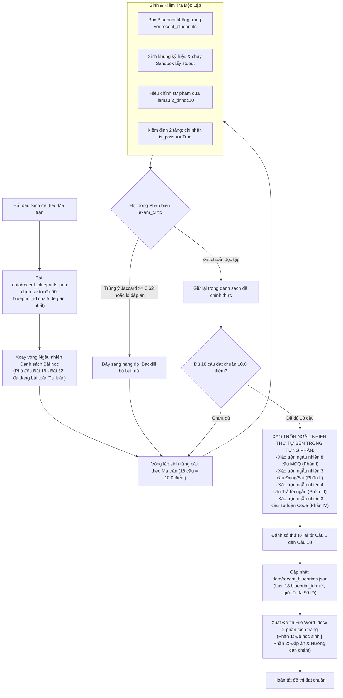

# Hệ Thống Sơ Đồ Kiến Trúc – AI Agentic RAG Khảo Thí Tin Học 10 (Chủ Đề F – Python)

Tài liệu tổng hợp **6 sơ đồ kiến trúc chuẩn Mermaid** phục vụ báo cáo NCKH, thuyết minh đề tài và trình bày hội đồng khoa học. Hệ thống triển khai 100% cục bộ trên phần cứng biên GPU phổ thông **4GB VRAM – NVIDIA RTX 3050** với mô hình ngôn ngữ `llama3.2_tinhoc10` (Ollama 3B), cơ sở dữ liệu vector `ChromaDB v2`, động cơ ký hiệu `Symbolic Engine` (155 blueprints) và môi trường thực thi cô lập `Python Sandbox`.

---

## Sơ đồ 1: Tổng quan Kiến trúc Hệ thống 3 Lớp Neuro-Symbolic Agentic RAG

---

## Sơ đồ 2: Luồng Triển Khai & Chia Sẻ Công Khai Qua Cloudflare Tunnel

---

## Sơ đồ 3: Chu Trình LangGraph & Vòng Lặp Tự Sửa Lỗi (StateGraph)

```mermaid
stateDiagram-v2
    [*] --> Retrieve_Evidence: Nhận yêu cầu Bài học, Dạng câu hỏi, Mức độ
    
    state Retrieve_Evidence {
        [*] --> Khoa_Bai_Hoc: Khóa cứng metadata bài học từ Bài 16 đến Bài 32
        Khoa_Bai_Hoc --> Lay_Chunk: Lấy top-k chunk từ ChromaDB v2
        Lay_Chunk --> Nap_Glossary: Bổ sung thuật ngữ từ grounded_glossary.json
    }

    Retrieve_Evidence --> Build_Skeleton: Nạp Evidence Package
    
    state Build_Skeleton {
        [*] --> Loc_Recent: Tra cứu recent_blueprints.json (chống lặp 5 đề)
        Loc_Recent --> Random_Param: Sinh biến số, xâu, danh sách ngẫu nhiên
        Random_Param --> Chay_Sandbox: Thực thi mã lệnh qua core/sandbox.py
        Chay_Sandbox --> Khoa_Dap_An: Khóa cứng stdout và verified_explanation
    }

    Build_Skeleton --> Generate_Node: Khung Skeleton hợp lệ
    
    state Generate_Node {
        [*] --> Prompt_Assembly: Ghép khung ký hiệu + Bằng chứng SGK
        Prompt_Assembly --> Call_Ollama: Gửi request tới llama3.2_tinhoc10
        Call_Ollama --> Parse_JSON: Bóc tách cấu trúc câu hỏi JSON
        Parse_JSON --> Merge_Symbolic: Ghi đè đáp án & giải thích từ Skeleton
    }

    Generate_Node --> Validate_Node: Chuyển sang kiểm định 2 tầng
    
    state Validate_Node {
        [*] --> Hard_Gate: Tầng 1 - Cú pháp Python AST, cấm thư viện ngoài, đơn trị
        Hard_Gate --> Sandbox_Check: Thực thi mã câu dẫn / đáp án mẫu
        Sandbox_Check --> Fuzzy_Scoring: Tầng 2 - Chấm điểm chất lượng [0.0 - 1.0]
    }

    Validate_Node --> Success: is_pass == True (Fuzzy >= 0.75)
    Validate_Node --> Generate_Node: is_pass == False & retry < 2 (Kèm phản hồi sửa lỗi)
    Validate_Node --> Backfill_Queue: is_pass == False & retry >= 2 (Đẩy sang bù vét)

    Success --> [*]
    Backfill_Queue --> [*]
```

---

## Sơ đồ 4: Cơ Chế Kiểm Định 2 Tầng (Two-Tier Validator & Sandbox)

---

## Sơ đồ 5: Quản Trị Bộ Nhớ Biên GPU 4GB VRAM & Tách Pha Xử Lý

---

## Sơ đồ 6: Luồng Ghép Đề Ma Trận, Chống Trùng Xuyên 5 Mã Đề & Xáo Trộn Đề Thi

